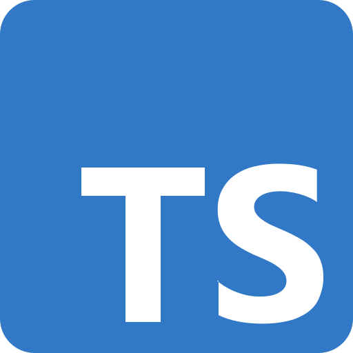
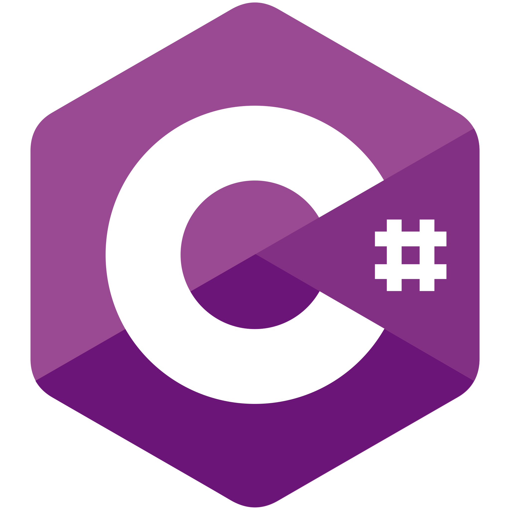
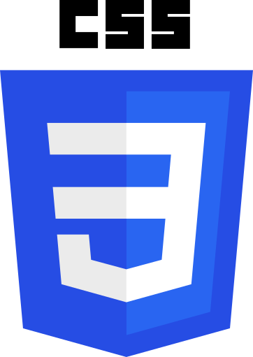
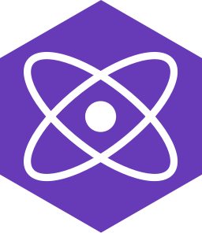
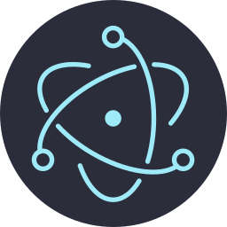

<!-- Header -->
<h1 align="center">
  
  <br>
  Hi, I'm Nguyễn Nhật Huy - aka oHTGo 
</h1>

<p align="center">
  <b>I'm a passionate programmer who loves to code</b>
</p>

<p align="center">
  
</p>

- ♑ I am creatively curious and a self-learner. I love exploring new technologies and currently learning new skills.
- 📓 I'm a student of [VNU HCMC FPT University](https://hcmuni.fpt.edu.vn).
- 👨🏻‍💻 I am working at [F-Code](https://www.facebook.com/fcodefpt) as a **Backend Crew Leader**.
- 🌱 I’m currently focusing on **Backend Web Development** and practicing **Frontend Web Development** and **DevOps** everyday.
- 💬 I’m looking forward to contributing to **Open Source Projects**.
- Show ❤ by giving ⭐ to my Repositories, at least your star could make someone's day 😄.

<!-- Tech stack -->
<h2>Tech stack 🔭</h2>
<p align="center">
  <b>Languages</b>
  <br>
  <br>
  <a href="https://en.wikipedia.org/wiki/C_(programming_language)" target="_blank">
    <code></code>
  </a>
  <a href="https://developer.mozilla.org/en-US/docs/Web/JavaScript" target="_blank">
    <code></code>
  </a>
  <a href="https://www.typescriptlang.org" target="_blank">
    <code></code>
  </a>
  <a href="https://www.java.com" target="_blank">
    <code></code>
  </a>
  <a href="https://go.dev" target="_blank">
    <code></code>
  </a>
  <a href="https://dotnet.microsoft.com/en-us/languages/csharp" target="_blank">
    <code></code>
  </a>
</p>

<br>
<br>

<p align="center">
  <b>Frontend</b>
  <br>
  <br>
  <a href="https://developer.mozilla.org/en-US/docs/Web/HTML" target="_blank">
    <code></code>
  </a>
  <a href="https://developer.mozilla.org/en-US/docs/Web/CSS" target="_blank">
    <code></code>
  </a>
  <a href="https://developer.mozilla.org/en-US/docs/Web/JavaScript" target="_blank">
    <code></code>
  </a>
  <a href="https://www.typescriptlang.org" target="_blank">
    <code></code>
  </a>
  <br>
  <a href="https://reactjs.org" target="_blank">
    <code></code>
  </a>
  <a href="https://preactjs.com" target="_blank">
    <code></code>
  </a>
  <a href="https://nextjs.org" target="_blank">
    <code></code>
  </a>
</p>

<br>
<br>

<p align="center">
  <b>Backend</b>
  <br>
  <br>
  <a href="https://nodejs.org" target="_blank">
    <code></code>
  </a>
  <br>
  <a href="https://expressjs.com" target="_blank">
    <code></code>
  </a>
  <a href="https://nestjs.com" target="_blank">
    <code></code>
  </a>
  <a href="https://spring.io" target="_blank">
    <code></code>
  </a>
  <a href="https://dotnet.microsoft.com" target="_blank">
    <code></code>
  </a>
  <br>
  <a href="https://mongodb.com" target="_blank">
    <code></code>
  </a>
  <a href="https://www.mysql.com" target="_blank">
    <code></code>
  </a>
  <a href="https://www.microsoft.com/en-us/sql-server" target="_blank">
    <code></code>
  </a>
  <a href="https://redis.io" target="_blank">
    <code></code>
  </a>
  <br>
  <a href="https://firebase.google.com" target="_blank">
    <code></code>
  </a>
  <a href="https://supabase.com" target="_blank">
    <code></code>
  </a>
</p>

<br>
<br>

<p align="center">
  <b>System & DevOps</b>
  <br>
  <br>
  <a href="https://en.wikipedia.org/wiki/Microsoft_Windows" target="_blank">
    <code></code>
  </a>
  <a href="https://en.wikipedia.org/wiki/Linux" target="_blank">
    <code></code>
  </a>
  <br>
  <a href="https://docker.com" target="_blank">
    <code></code>
  </a>
  <a href="https://www.nginx.com" target="_blank">
    <code></code>
  </a>
  <a href="https://pm2.keymetrics.io" target="_blank">
    <code></code>
  </a>
  <br>
  <a href="https://cloud.google.com" target="_blank">
    <code></code>
  </a>
  <a href="https://www.heroku.com" target="_blank">
    <code></code>
  </a>
  <a href="https://azure.microsoft.com" target="_blank">
    <code></code>
  </a>
</p>

<br>
<br>

<p align="center">
  <b>Other</b>
  <br>
  <br>
  <a href="https://www.electronjs.org" target="_blank">
    <code></code>
  </a>
</p>

<!-- My activity -->
<h2>My activity </h2>
<details> 
  <summary><b>💻 Profile Stats</b></summary>
  <br>
  <p align="center">
    
    <br>
	  
    <br>
    <b>Note:</b> Top languages is only a metric of the languages my public code consists of and doesn't reflect experience or skill level.
    <br>
    <br>
    
  </p>
</details>
<details>
  <summary><b>⚡ GitHub Contribution</b></summary>
  <br>
  <p></p>
  <br>
</details>
<details> 
  <summary><b>📊 Wakatime Stats</b></summary>
  <br>
  
<!--START_SECTION:waka-->


**I'm a Night 🦉** 

```text
🌞 Morning                361 commits         ⣿⣿⣿⣿⣿⣀⣀⣀⣀⣀⣀⣀⣀⣀⣀⣀⣀⣀⣀⣀⣀⣀⣀⣀⣀   18.77 % 
🌆 Daytime                481 commits         ⣿⣿⣿⣿⣿⣿⣀⣀⣀⣀⣀⣀⣀⣀⣀⣀⣀⣀⣀⣀⣀⣀⣀⣀⣀   25.01 % 
🌃 Evening                795 commits         ⣿⣿⣿⣿⣿⣿⣿⣿⣿⣿⣀⣀⣀⣀⣀⣀⣀⣀⣀⣀⣀⣀⣀⣀⣀   41.34 % 
🌙 Night                  286 commits         ⣿⣿⣿⣿⣀⣀⣀⣀⣀⣀⣀⣀⣀⣀⣀⣀⣀⣀⣀⣀⣀⣀⣀⣀⣀   14.87 % 
```
📅 **I'm Most Productive on Monday** 

```text
Monday                   330 commits         ⣿⣿⣿⣿⣀⣀⣀⣀⣀⣀⣀⣀⣀⣀⣀⣀⣀⣀⣀⣀⣀⣀⣀⣀⣀   17.16 % 
Tuesday                  305 commits         ⣿⣿⣿⣿⣀⣀⣀⣀⣀⣀⣀⣀⣀⣀⣀⣀⣀⣀⣀⣀⣀⣀⣀⣀⣀   15.86 % 
Wednesday                311 commits         ⣿⣿⣿⣿⣀⣀⣀⣀⣀⣀⣀⣀⣀⣀⣀⣀⣀⣀⣀⣀⣀⣀⣀⣀⣀   16.17 % 
Thursday                 167 commits         ⣿⣿⣀⣀⣀⣀⣀⣀⣀⣀⣀⣀⣀⣀⣀⣀⣀⣀⣀⣀⣀⣀⣀⣀⣀   08.68 % 
Friday                   230 commits         ⣿⣿⣿⣀⣀⣀⣀⣀⣀⣀⣀⣀⣀⣀⣀⣀⣀⣀⣀⣀⣀⣀⣀⣀⣀   11.96 % 
Saturday                 297 commits         ⣿⣿⣿⣿⣀⣀⣀⣀⣀⣀⣀⣀⣀⣀⣀⣀⣀⣀⣀⣀⣀⣀⣀⣀⣀   15.44 % 
Sunday                   283 commits         ⣿⣿⣿⣿⣀⣀⣀⣀⣀⣀⣀⣀⣀⣀⣀⣀⣀⣀⣀⣀⣀⣀⣀⣀⣀   14.72 % 
```


📊 **This Week I Spent My Time On** 

```text
🕑︎ Time Zone: Asia/Ho_Chi_Minh

💬 Programming Languages: 
Docker                   58 mins             ⣿⣿⣿⣿⣿⣿⣀⣀⣀⣀⣀⣀⣀⣀⣀⣀⣀⣀⣀⣀⣀⣀⣀⣀⣀   22.89 % 
JSON                     47 mins             ⣿⣿⣿⣿⣿⣀⣀⣀⣀⣀⣀⣀⣀⣀⣀⣀⣀⣀⣀⣀⣀⣀⣀⣀⣀   18.60 % 
Diff                     36 mins             ⣿⣿⣿⣿⣀⣀⣀⣀⣀⣀⣀⣀⣀⣀⣀⣀⣀⣀⣀⣀⣀⣀⣀⣀⣀   14.24 % 
TOML                     32 mins             ⣿⣿⣿⣀⣀⣀⣀⣀⣀⣀⣀⣀⣀⣀⣀⣀⣀⣀⣀⣀⣀⣀⣀⣀⣀   12.50 % 
Other                    27 mins             ⣿⣿⣿⣀⣀⣀⣀⣀⣀⣀⣀⣀⣀⣀⣀⣀⣀⣀⣀⣀⣀⣀⣀⣀⣀   10.73 % 

🔥 Editors: 
VS Code                  3 hrs 39 mins       ⣿⣿⣿⣿⣿⣿⣿⣿⣿⣿⣿⣿⣿⣿⣿⣿⣿⣿⣿⣿⣿⣀⣀⣀⣀   85.55 % 
Copilot CLI              37 mins             ⣿⣿⣿⣿⣀⣀⣀⣀⣀⣀⣀⣀⣀⣀⣀⣀⣀⣀⣀⣀⣀⣀⣀⣀⣀   14.45 % 
```

🤖 **AI Coding This Week** 

```text
⏱ AI Coding Time: 1 hr 5 mins (25.53%)

✍️ 0 lines written by AI, 173 lines written by hand (0.0% AI-written)

🔤 142,452 Input Tokens, 16,564 Output Tokens

💵 $0.07 Estimated AI Cost This Week

🧠 1 AI Sessions, 10 AI Prompts

GPT                      0 lines             ⣀⣀⣀⣀⣀⣀⣀⣀⣀⣀⣀⣀⣀⣀⣀⣀⣀⣀⣀⣀⣀⣀⣀⣀⣀   00.00 % 

🔎 AI Coding Insights:
🧑‍💻 Mostly Hands-On — 0.0% of written lines came from AI
📝 Concise Prompter — average 97 characters per prompt
🔁 Iterative Prompter — average 10 prompts per session
🔍 Hands-On Reviewer — 100.0% of changed lines were hand-edited
```


<!--END_SECTION:waka-->
</details>

<!-- Connection -->
<h2> Connect with me </h2>
<p align="center">
  <a href="https://s.ohtgo.me/facebook" target="_blank">
    <code></code>
  </a>
  <a href="https://s.ohtgo.me/instagram" target="_blank">
    <code></code>
  </a>
</p>
